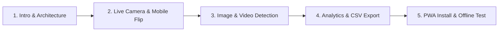

# EdgeVision AI

> **EDGE AI-BASED REAL-TIME OBJECT DETECTION FOR SMART MEDIA APPLICATIONS**  

[](https://developer.mozilla.org/en-US/docs/Web/Progressive_web_apps)
[](https://docs.ultralytics.com/models/yolo11/)
[](https://www.w3.org/TR/webgpu/)
[-22c55e.svg)](#privacy-guarantee)

---

## 📌 Project Overview

**EdgeVision AI** is a portable, responsive, installable **Progressive Web App (PWA)** that executes real-time computer vision inference directly within the user's web browser. Powered by **YOLO11n** and **ONNX Runtime Web**, EdgeVision AI provides hardware-accelerated object detection without transmitting raw video frames or photos to a remote cloud server.

### Key Highlights
- **100% Client-Side Edge Inference:** No cloud inference server, paid APIs, backend database, or subscriptions required.
- **Installable PWA:** Can be installed on Windows, macOS, Linux, ChromeOS, Android, and iOS devices with full standalone window support.
- **True Offline Operation:** Caches the complete app shell, bundled YOLO11n ONNX model (`10.7 MB`), and ONNX Runtime WebAssembly SIMD runtime for offline detection without internet connectivity.
- **Hardware Acceleration:** Auto-negotiates the fastest execution provider—preferring **WebGPU** for GPU shader execution and gracefully falling back to **WebAssembly (WASM SIMD)** on devices without WebGPU.
- **Multi-Media Smart Media Pipeline:** Supports live camera feeds (front/back camera flipping), static image uploads (drag & drop), and local HTML5 video playback.

---

## 🚀 Key Modules & Capabilities

1. **Academic Dashboard & Telemetry**
   - Live telemetry cards: Total detections, unique classes, active FPS, inference latency (ms), active engine, and snapshots.
   - Visual 6-step Edge AI processing pipeline illustrating media ingest $\to$ 640×640 letterbox $\to$ YOLO11n $\to$ WebGPU/WASM $\to$ NMS $\to$ Local Analytics.
2. **Unified Detection Workspace**
   - **Live Camera Mode:** Real-time webcam feed with responsive letterbox mapping (4:3, 16:9), unmirrored coordinates, dynamic camera selector, and instant mobile camera flipping (🔄 Flip Camera).
   - **Static Image Mode:** Drag-and-drop or file browsing for JPG, PNG, and WebP images with instant YOLO11n bounding boxes, labels, and latency report.
   - **Local Video Mode:** Client-side video playback (.mp4, .webm) with throttled frame-by-frame inference loop and synchronized overlay canvas.
3. **Session Analytics & Insights**
   - Temporal cooldown filter (prevents raw frame-by-frame counter inflation).
   - Real-time frequency bar charts, chronological audit log, and most-detected object counter.
   - One-click CSV export and history purge.
4. **PWA & Offline System**
   - Service Worker (`sw.js`) implementing a hybrid cache strategy (Stale-While-Revalidate for app shell, Cache-First for neural network and WASM binaries).
   - Dynamic online/offline indicator pill with toast alerts upon network transition.
   - Storage inspection displaying current Cache Storage utilization and quota.
5. **Universal Model & Settings Center**
   - Bundled pretrained YOLO11n with 80 COCO classes.
   - Universal YOLO output tensor adapter supporting both `[1, 4+C, N]` (transposed) and `[1, N, 4+C]` layouts.
   - Optional custom ONNX model validation with tensor shape inspector and safe reset to default YOLO11n.
   - Synchronized confidence threshold slider (20% – 90%).
6. **Universal Watermarked Snapshot**
   - Captures active media frames with burned-in bounding boxes, confidence tags, and timestamp watermark into a downloadable PNG.

---

## 🛠️ Technology Stack

| Layer | Technologies Used |
| :--- | :--- |
| **Frontend UI** | HTML5 (Semantic DOM), CSS3 (Grid & Flexbox), Responsive Dark Theme |
| **PWA Stack** | Web App Manifest (`manifest.json`), Service Worker (`sw.js`), Cache API |
| **Core Logic** | Modern JavaScript (ES6 Modules, Zero-Allocation Offscreen Canvas buffers) |
| **Neural Network** | Ultralytics YOLO11n (`models/yolo11n.onnx`, 10.7 MB, COCO 80 classes) |
| **Inference Engine** | ONNX Runtime Web 1.21.0 (`vendor/ort.all.min.mjs` & WASM binaries) |
| **Hardware Accel** | WebGPU API (Compute Shaders) with WebAssembly SIMD fallback |
| **Media Capture** | WebRTC `navigator.mediaDevices.getUserMedia` & HTML5 Video/Canvas |

---

## 📱 Device & Browser Compatibility

EdgeVision AI is engineered with feature detection to deliver consistent behavior across diverse devices:

| Platform | Recommended Browser | Accelerated Engine | Offline Support |
| :--- | :--- | :--- | :---: |
| **Windows / macOS / Linux** | Google Chrome 113+, Microsoft Edge 113+ | WebGPU (DirectX 12 / Vulkan / Metal) | ✅ Yes |
| **Windows / macOS / Linux** | Mozilla Firefox 120+ | WebAssembly SIMD | ✅ Yes |
| **Android Smartphones & Tablets** | Chrome 121+, Edge Mobile | WebGPU / WASM SIMD | ✅ Yes |
| **iPhone & iPad (iOS 16.4+)** | Apple Safari, Chrome for iOS | WebAssembly SIMD (WASM) | ✅ Yes (Add to Home Screen) |

> [!NOTE]
> WebGPU is automatically utilized when available in the browser. If WebGPU is unavailable or disabled, EdgeVision AI automatically falls back to CPU WebAssembly SIMD without interrupting the user.

---

## 💻 How to Run Locally

Because modern web browsers require a **Secure Context** (`localhost` or `HTTPS`) for Camera access (`getUserMedia`) and Service Worker registration:

### Option 1: Python HTTP Server (Recommended)
1. Open PowerShell or Terminal in the project root:
   ```powershell
   cd C:\Users\user\OneDrive\Documents\Projects\EdgeVision_AI_V5
   ```
2. Launch a local web server:
   ```powershell
   python -m http.server 8000
   ```
3. Open your browser to:
   ```text
   http://localhost:8000/EdgeVision_AI_V5/index.html
   ```
   *(or `http://localhost:8000/` which automatically redirects)*

### Option 2: VS Code Live Server
1. Open the project folder in VS Code.
2. Right-click `EdgeVision_AI_V5/index.html` and select **Open with Live Server**.

---

## 🌐 Public Deployment Guide

EdgeVision AI uses relative asset paths (`./`), making it 100% portable for any static HTTPS hosting service.

### Deploying to Netlify (1-Click Static)
1. Push this repository to GitHub or GitLab.
2. Log in to [Netlify](https://app.netlify.com/) and click **Add new site > Import an existing project**.
3. Choose your repository.
4. Set the build settings:
   - **Base directory:** Leave blank (or `.`)
   - **Publish directory:** `EdgeVision_AI_V5` (or use the root `netlify.toml` which configures this automatically)
5. Click **Deploy Site**. Netlify provides an instant, secure HTTPS URL (e.g., `https://edgevision-ai.netlify.app`).

### Deploying to GitHub Pages
1. Push this repository to GitHub.
2. In your repository on GitHub, navigate to **Settings > Pages**.
3. Under **Build and deployment > Source**, select **Deploy from a branch**.
4. Select branch `main` and folder `/ (root)` or `/docs`.
5. Click **Save**. Within 1–2 minutes, your site will be live at:
   ```text
   https://<username>.github.io/<repository-name>/
   ```
   The root `index.html` automatically forwards traffic to `EdgeVision_AI_V5/`.

---

## 📲 How to Install the Progressive Web App (PWA)

### On Desktop (Chrome / Edge):
1. Visit the app in Chrome or Edge.
2. Click the **📲 Install App** button in the top navigation bar, or click the install icon in the browser address bar.
3. EdgeVision AI will open as a dedicated, frameless desktop application.

### On Android:
1. Visit the site in Chrome for Android.
2. Tap the **📲 Install App** button or the browser banner **Add EdgeVision AI to Home screen**.
3. Launch directly from your app drawer.

### On iOS (iPhone / iPad):
1. Open the site in **Safari**.
2. Tap the **Share** button (⎋) at the bottom.
3. Scroll down and tap **Add to Home Screen** (⊞).
4. Tap **Add** in the top right corner.

---

## 📶 Testing Offline Operation

Once EdgeVision AI has been opened once while online:
1. Turn off your Wi-Fi or enable Airplane Mode (or toggle offline in Chrome DevTools > Network tab > "Offline").
2. Notice the network indicator switches to **🟠 Offline (PWA)** with a toast alert.
3. Refresh or restart the browser. The page shell, CSS, icons, and YOLO11n neural network load instantly from local Cache Storage!
4. Switch to **Image Detection**, upload a photo, and click **Run Detection**—on-device AI runs with zero internet connection!

---

## 🎯 Recommended Viva Demonstration Walkthrough

When presenting EdgeVision AI to evaluators or professors:



1. **Introduction & Motivation (2 min):**
   - Point out the academic badge: *2nd-Year B.Tech Project*.
   - Explain the core concept: Traditional computer vision uploads high-resolution streams to costly cloud servers; EdgeVision AI processes frames 100% on the edge device with zero cloud egress.
2. **Edge Architecture & Privacy (2 min):**
   - Scroll to the **Architecture** section and explain the 4-tier pipeline: Media Ingest $\to$ 640×640 Preprocessor $\to$ YOLO11n ONNX $\to$ Non-Maximum Suppression.
   - Highlight the **Privacy Guarantee**: 0 bytes leave the device.
3. **Multi-Media Detection (4 min):**
   - **Camera:** Start camera, showcase real-time bounding boxes with class labels and confidence percentages. Click **🔄 Flip Camera** to cycle inputs.
   - **Snapshot:** Click **Snapshot** to download a framed PNG with timestamp watermark.
   - **Static Image:** Switch to Image Detection tab, drag a sample image, run detection, and review latency.
   - **Video:** Switch to Video Detection tab, upload an MP4 clip, and show real-time frame tracking.
4. **Analytics & Data Export (2 min):**
   - Open **Analytics**: Review Total Events, Unique Classes, and the **Most Detected Object**.
   - Download the detection history via **Export CSV**.
5. **PWA Installation & Offline Proof (2 min):**
   - Click **📲 Install App** to showcase PWA installation.
   - Disconnect Wi-Fi (or toggle Offline mode in DevTools), reload the page, and show that EdgeVision AI continues detecting objects completely offline!

---

## 📄 License & Academic Attribution

Developed as an academic demonstration for the **2nd-Year B.Tech Computer Science & Engineering** curriculum.  
Powered by [Ultralytics YOLO11](https://github.com/ultralytics/ultralytics) and [ONNX Runtime Web](https://github.com/microsoft/onnxruntime).
